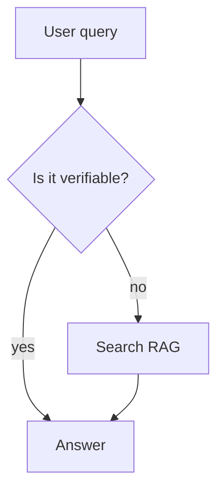
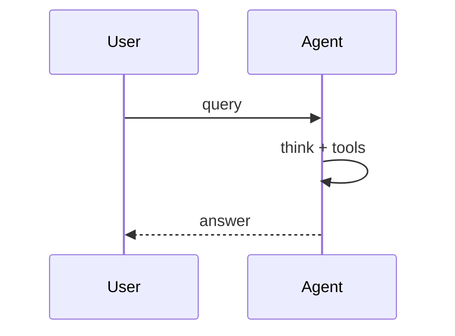

# llmfun-mermaid

The llmfun TUI draws ```mermaid code blocks directly. It supports a subset of
mermaid and lays diagrams out its own way: a diagram that renders fine
elsewhere may render differently or not at all here.

## When to Use

- You are about to write a ```mermaid block in anything the TUI will render.
- You need to know whether a mermaid feature will be drawn or silently ignored.

## Rules

1. Supported headers: `flowchart`/`graph` (TD, TB, BT, LR, RL),
   `sequenceDiagram`, `classDiagram`. Everything else (state, ER, gantt, pie,
   git graph, mindmap, timeline, ...) is NOT drawn: the block shows as code.
   `flowchart-elk` and `classDiagram-v2` are read as the basic variants.
2. Keep diagrams small to medium. Large diagrams and dense same-layer edges
   render poorly in the TUI's own layout.
3. An unparseable diagram is shown as code with the failing line number. If a
   diagram must not fail, stay inside the supported subset (see References).
4. Styling lines (`classDef`, `class`, `style`, `linkStyle`, `cssClass`,
   `click`, `callback`, `link`) and `%%{init: ...}%%` directives are read and
   IGNORED. Never put meaning in styling.
5. Labels are plain text: `<br>` breaks a line; markdown-in-labels, other HTML
   tags and icons (`fa:fa-car`) show as written.
6. Sequence diagrams: do not use `box` groups, `create`/`destroy`, or
   participant types (`participant A@{ "type": ... }`) - they make the whole
   diagram show as code. `links` lines are ignored.
7. Flowcharts: avoid the `A@{ shape: ... }` syntax, edge ids, images/icons in
   nodes, and link lengths (`--->` is read as `-->`). Direction shorthands
   (`>`, `<`, `^`, `v`) are not supported. Edges are straight segments with
   right angles, no curves.

## Examples





## Workflow

1. Prefer prose unless a diagram explains structure better than prose.
2. Pick a supported type; write the block; keep node labels short.
3. When unsure about a feature, check the supported-subset doc in References.

## References

- `references/mermaid.md` - the supported-subset documentation, digested for
  agent use. Derived from `vendor/imgui_rich_md/docs/mermaid.md` (the
  canonical doc); update the copy when the vendored doc changes.
